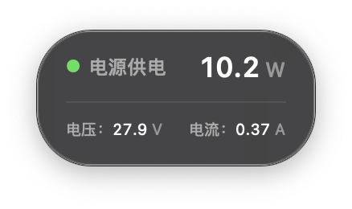
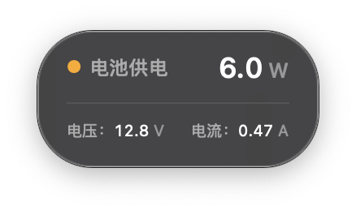

# PowerHUD

**A tiny floating macOS HUD that shows real-time power draw.**
**一个显示实时功率的 macOS 悬浮小卡片。**




## Features / 功能

- ⚡ **Real-time power** — adapter input while plugged in, battery discharge while on battery; refreshes every second
- 🎨 **Frosted-glass floating card** — always on top, draggable, remembers its position
- 🟢🟠 **Supply-aware** — green dot "电源供电" when the adapter feeds the system, orange "电池供电" when the battery does; the handover after plugging/unplugging is shown faithfully
- 🛠 **Built-in style tuner** — right-click → 调整样式… to tweak size, fonts, spacing and corner radius live

> 中文简介：PowerHUD 是一个常驻桌面的极简功率监控小窗。插电时显示适配器输入功率，电池供电时显示放电功率，并展示电压、电流与电量；毛玻璃卡片始终置顶、可拖动，内置样式调整面板，无需任何后台服务或开发者账号。

## Screenshots / 截图

| AC power · 电源供电 | On battery · 电池供电 |
|---|---|
|  |  |

## How it works / 工作原理

PowerHUD samples the battery controller via `ioreg -rn AppleSmartBattery -w0` once per second and reads the `PowerTelemetryData` dictionary:

| Key | Meaning |
|---|---|
| `SystemPowerIn` / `SystemVoltageIn` / `SystemCurrentIn` | adapter input power / voltage / current (mW / mV / mA) |
| `BatteryPower` | battery rail power (negative = discharging) |

A couple of gotchas the code handles:

- ioreg prints negative 64-bit values as unsigned (two's complement), e.g. `18446744073709550695` is really −921 mA.
- When the battery charge is above the charge limit, macOS keeps running off the battery even while plugged in. PowerHUD follows the actual power flow instead of the cable state, and shows the gradual handover when the adapter takes over.

## Build / 构建

Requires macOS 12+ and Xcode Command Line Tools. No dependencies.

```bash
swiftc -O main.swift -o PowerHUD.app/Contents/MacOS/PowerHUD
cp Info.plist PowerHUD.app/Contents/Info.plist
codesign --force --sign - PowerHUD.app
open PowerHUD.app
```

The app is ad-hoc signed and runs locally without a developer account. If you distribute it to others, they will need a Developer ID signature and notarization, or they can bypass Gatekeeper manually.

## Usage / 使用

- Drag the card anywhere — its position is remembered across launches.
- Right-click for: 始终置顶 (always on top) · 调整样式… (style tuner) · 退出 (quit).
- Launch at login: System Settings → General → Login Items → add `PowerHUD.app`.

## Compatibility / 兼容性

Built and tested on macOS 15 with Apple Silicon (MacBook Pro). Intel Macs may expose slightly different battery telemetry keys.

## License / 许可

[MIT](LICENSE) © 2026 okicando
